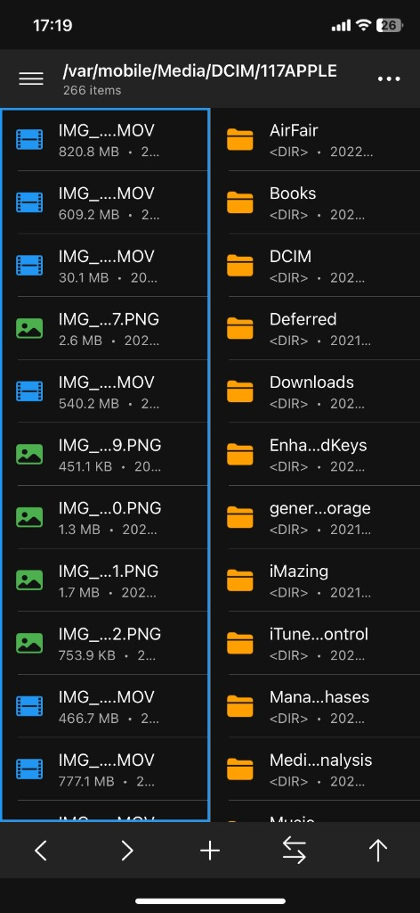
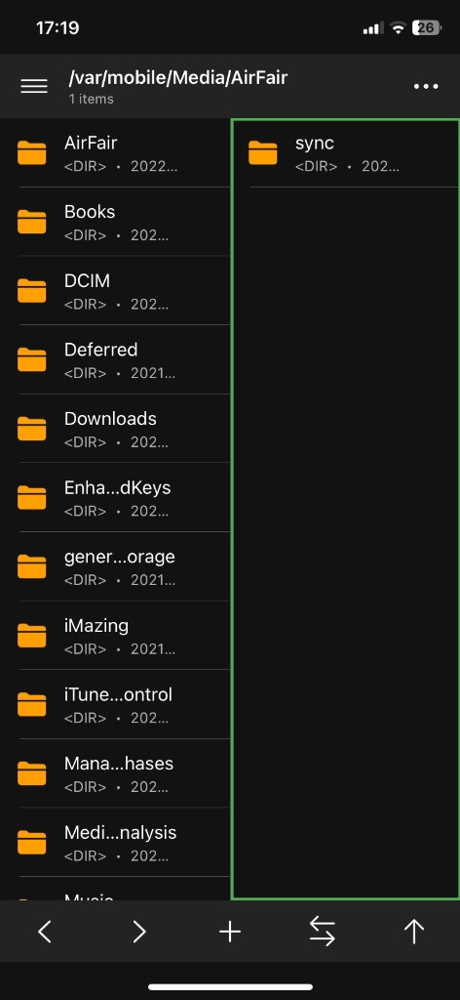
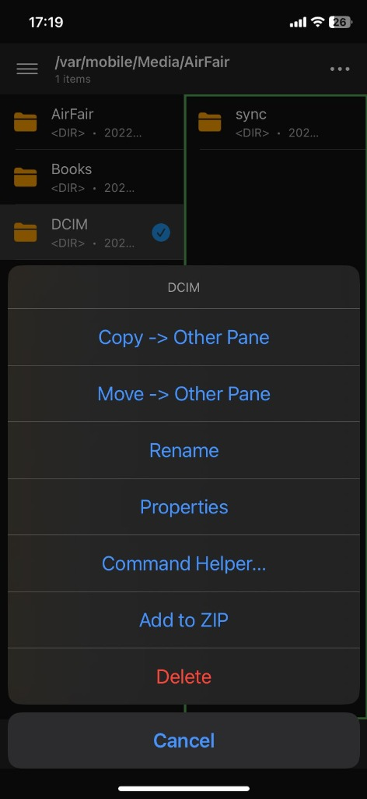
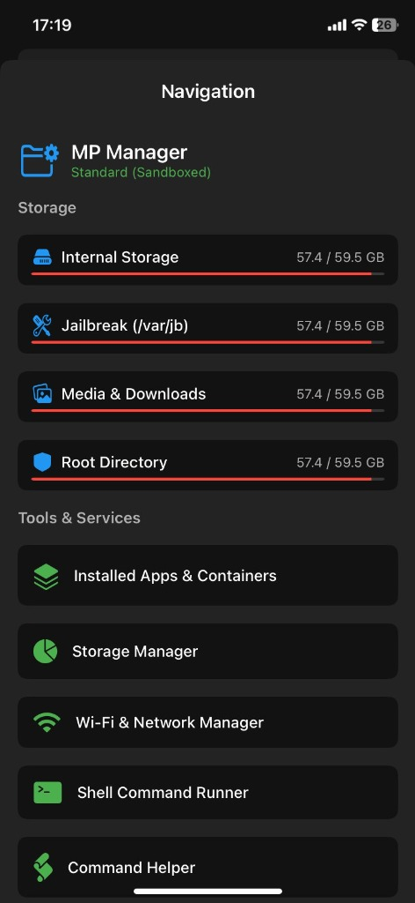
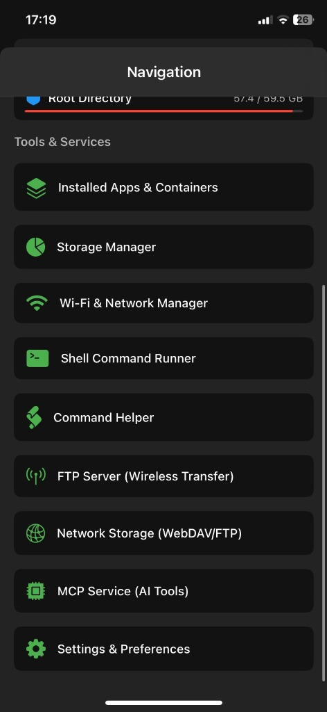
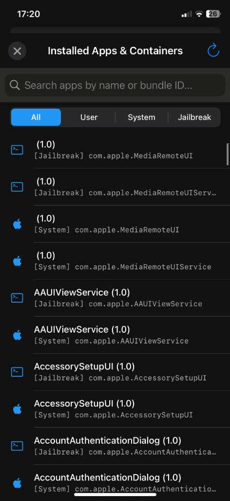
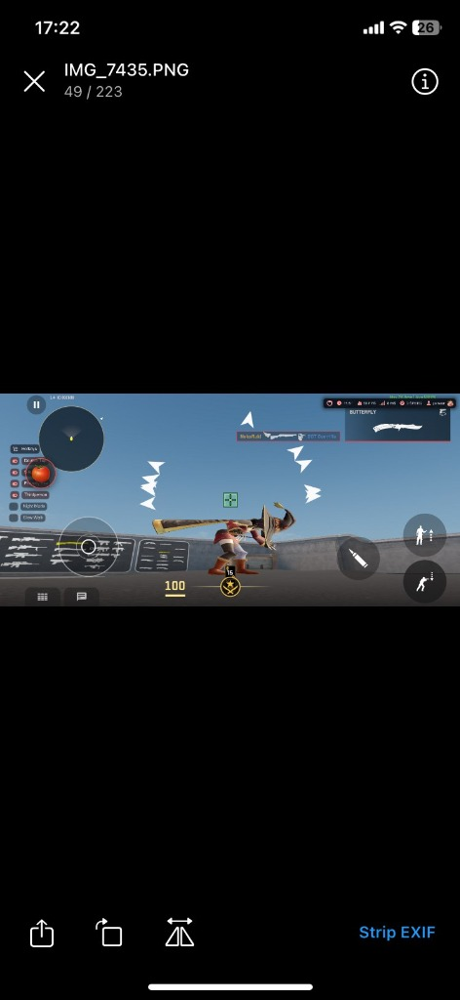
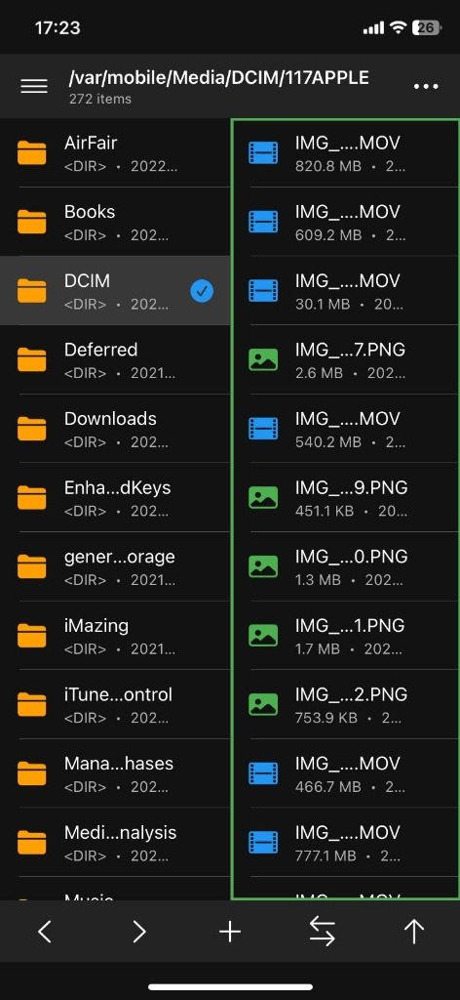

# MP Manager for iOS (Dopamine Rootless)

A free, native dual-pane file manager, APK/binary reverse engineering suite, and MCP server for iOS designed specifically for jailbroken devices running **Dopamine 2**, **Dopamine 3**, and **RootHide**.

Direct native port of the open-source [MP Manager](https://github.com/AbdurazaaqMohammed/MP-Manager) by Abdurazaaq Mohammed, faithfully replicating MT Manager's dual-pane paradigm on iOS with full rootless jailbreak privileges.

---

## Preview & Screenshots

| Dual Pane (Left Active) | Dual Pane (Right Active) | Context Actions |
|:---:|:---:|:---:|
|  |  |  |

| Navigation & Storage | Tools & Services Hub | App Containers |
|:---:|:---:|:---:|
|  |  |  |

| Image Viewer & Editor | File Browser & Panes |
|:---:|:---:|
|  |  |

---

## Features

- **Authentic Dual-Pane Navigation**: Browse two directories side by side in independent viewports, highlighted with an active pane accent border (`#2196F3` / `#4CAF50`). Easily copy or move files across panes with one tap.
- **Rootless & Sandboxed Filesystem Access**: Direct access to `/var/jb`, `/var/mobile`, `/Library`, `/Applications`, and system volumes using POSIX system calls (`opendir`, `readdir`, `lstat`).
- **Privilege Elevation (`mpRootHelper`)**: Bundled setuid root helper (`chmod 4755`, owned by `0:0`) enabling uninhibited recursive deletions, permissions modifications (`chmod`/`chown`), and archive extraction in protected system folders.
- **Media & Document Viewers**:
  - **Audio & Video Player**: Integrated `AVPlayer` with seek slider, play/pause, 10s skip, background audio, and full-screen video playback.
  - **Image Viewer & Editor**: Continuous swipe between folder photos, pinch-to-zoom, EXIF metadata inspector, 90° rotation, flip, and private EXIF data stripping (**Strip EXIF**).
  - **PDF Viewer**: Continuous scroll reader with in-document search and share sheet powered by `PDFKit`.
- **Installed Apps & Container Management**:
  - Browse User, System, and Jailbreak installed apps with bundle IDs and versions.
  - Jump directly to App Bundle binaries or Data Sandbox Containers (`/var/mobile/Containers/Data/Application/<UUID>`).
- **Utilities & Developer Tool Packs**:
  - **Batch Rename**: Prefix, suffix, `#` index padding, find & replace with live preview.
  - **Shell Command Runner**: Interactive terminal with real-time stdout/stderr capture via `posix_spawnp`, exit code badge, and setuid root switch.
  - **Command Helper**: Pre-configured templates (`chmod 755`, `ldid -S`, `dpkg-deb`, `otool -L`) and `$FILE`/`$DIR`/`$NAME` placeholder expansion.
  - **Storage Manager**: Storage meter via `statvfs` and top 50 largest files scanner.
  - **Wi-Fi & Network Manager**: BSD `getifaddrs` metrics (IPv4, Cellular, Netmask, Broadcast).
- **Model Context Protocol (MCP) Service**:
  - Full JSON-RPC 2.0 protocol layer compliant with MCP specification `2024-11-05`.
  - 23 on-device tools (`mp_file_*`, `mp_zip_*`, `mp_apk_*`, `mp_macho_*`, `mp_exec_command`, `mp_network_list`, `mp_ftp_server_status`).
  - Dual transports: Streamable HTTP at `http://<ip>:8787/mcp` and Legacy SSE at `/sse` & `/message`.
  - CORS-enabled with live audit logging and one-click JSON export for Claude Desktop, Cursor, and AI agents.
  - Background task persistence preventing suspension when the device is locked or minimized.
- **Network Storage & Wireless File Transfer**:
  - **Built-in FTP Server**: Turn your iOS device into an RFC 959 FTP server on port `2121` with one tap. Supports anonymous or password authentication, passive mode (PASV/EPSV), file upload/download, and background transfer keepalive.
  - **Native WebDAV Client**: Pure Swift implementation via `URLSession` and `XMLParser` with `PROPFIND` (Depth 1), `GET`, `PUT`, `MKCOL`, `DELETE`, and `MOVE`.
  - **Remote Files Browser**: Browse remote servers directly inside MP Manager with folder navigation, cross-pane transfers, remote folder creation, and direct remote file editing.
  - **Keychain Security**: Remote credentials (FTP, FTPS, SFTP, WebDAV, SMB) encrypted in the hardware-backed iOS Keychain.
- **Archive Engine**: Browse archive contents without extraction, extract selected entries, or create archives (`.zip`, `.tar.gz`, `.tar.bz2`, `.tar.xz`, `.7z`, `.rar`) with Zip Slip path traversal defense.
- **APK & Binary Tools**:
  - Decode binary `AndroidManifest.xml` (extract package, version, SDK constraints).
  - Inspect `classes.dex` headers and class counts.
  - Verify APK signature schemes (V1, V2, V3).
  - Inspect native `Mach-O` and `ELF` binaries (`LC_BUILD_VERSION`, segments, linked dylibs).
- **Built-in Editors & Viewers**:
  - **Text Editor**: Monospaced editor with line numbers, regex Find & Replace, and `.bak` backups.
  - **Hex Editor**: Dual-column hex view with ASCII pane and offset jumping.
  - **SQLite Browser**: View table schemas, inspect rows, and run custom queries.
  - **File Comparison (Diff)**: Side-by-side / unified text diff viewer.
  - **Checksum Calculator**: Real-time SHA-256, SHA-1, and MD5 computation.

---

## Compatibility

| Environment | Architecture | Supported iOS Versions | Status |
|---|---|---|---|
| **iPad Pro 11-inch (2018, A12X)** | `arm64e` | iPadOS 16.0 – 16.5.1 | Primary Target |
| **iPhone 11 Pro (A13)** | `arm64e` | iOS 16.0 – 16.5.1 | Secondary Target |
| **Dopamine 2** | `arm64`, `arm64e` | iOS 15.0 – 16.6.1 | Verified |
| **Dopamine 3** | `arm64`, `arm64e` | iOS 15.0 – 18.7.1, 26.0 – 26.0.1 | Verified |
| **RootHide** | `arm64e` | iOS 15.0 – 16.5.1 | Verified |

---

## Installation

### Via Sileo or Zebra
1. Download `mpmanager-rootless_1.1.0_iphoneos-arm.deb` from the [Releases](https://github.com/nekoruki04/MPManager-iOS/releases) page.
2. Open with **Sileo** or **Zebra**.
3. Tap **Get** / **Install** and confirm.
4. `uicache -p /var/jb/Applications/MPManager.app` will register the application on the SpringBoard home screen.

### Via Terminal (dpkg)
```bash
dpkg -i mpmanager-rootless_1.1.0_iphoneos-arm.deb
uicache -p /var/jb/Applications/MPManager.app
```

---

## Authors & License
- Upstream Author: **Abdurazaaq Mohammed** ([@AbdurazaaqMohammed](https://github.com/AbdurazaaqMohammed))
- iOS Port Maintainer: **nekoruki** ([@nekoruki04](https://github.com/nekoruki04))
- Licensed under the **GNU General Public License v3.0 (GPLv3)**.
